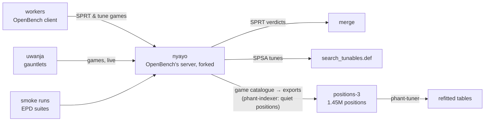

## v1.6.0 "Stride"

The search cycle. Same elephant, a better gait: 1.4 made the evaluation Elephant's own, 1.6 teaches the search where
to look harder and where to look less, then lets SPSA set its numbers. It is the first release with binaries since
1.3.2; 1.4.0 "Matriarch" was tagged but never published, so these notes start from it, and there is no 1.5.

Most of the gain is in search: singular extensions, continuation history and history in late move reductions. Then
two kinds of tuning, both new or redone this cycle: the search parameters by SPSA, and the evaluation tables refitted
on Elephant's games since 1.4. 1.6 is meant to live a while: each new SPSA run or table fit is a 1.6.x.

### Strength
About **3030 CCRL Blitz**, provisional: 1600 games at 2'+1" against 9 engines from the CCRL Blitz list rated
2978–3160, UHO_Lichess_4852_v1 openings, 256 MB hash, plus 1.4.0. Its performance against each opponent lies between
3002 and 3082. Head to head, **1.6.0 beat 1.4.0 by +75 ± 40**.

Provisional because the run played ten games at a time on a 6-core Ryzen 5 5500, so engines shared cores and played
at roughly two thirds of their usual speed. The head to head is fair either way, both Elephants ran under the same
conditions. 1.4.0's 3001 ± 22 came from a lower field (2663–3095) on a Ryzen 9 5950X, so the two ratings don't
compare directly; a clean rerun is planned.

### Highlights
- **Singular extensions.** When the transposition table's move is the only good one, a reduced search with that move
  left out proves it, and the move is searched a ply deeper. The engine's first extension beyond checks, and the
  largest single gain of the cycle.
- **Continuation history,** one and two plies back: quiet moves are ordered by how they did after the same previous
  moves, not only by square. History tables and pawn hashes carry over between the searches of one game.
- **History in late move reductions:** a quiet move with a good history is reduced less, one with a bad history more.
- **SPSA.** The search's numeric parameters are listed in one file, `search_tunables.def`; a tuning build
  (`make TUNE=1`, or CMake `ELEPHANT_TUNE`) exposes 29 of them as UCI options for nyayo's SPSA tunes, a release
  build compiles them in as constants. The first run moved reverse futility, futility, null move, history, quiescence
  and LMR constants a few percent each; together they were worth about +5.
- **Tables refitted on Elephant's own games since 1.4:** 1.45M positions from nyayo, the same groups as the 1.4 fit,
  starting from 1.4.0's values. The workflow is written down in `docs/tuning-guide.md`.

### The rig: nyayo
Every number in these notes, and the games the new tables were fitted on, came through
[nyayo](https://github.com/looak/nyayo). It began as a smoke test history and is now a fork of
[OpenBench](https://github.com/AndyGrant/OpenBench)'s server with a lot added: it took over OpenBench's job of
running SPRTs this cycle, and it keeps every game played as data.

What nyayo adds to OpenBench's server:
- **A catalogue of every game** (about 315,000 so far), queryable, and **exports**: datasets of quiet positions drawn
  from those games with `phant-indexer`, rebuildable from a recorded seed. 1.6's table fit is the first trained on a
  nyayo export of Elephant's own games since 1.4, and it was worth about +7 on its own.
- **SPSA tunes** with momentum, snapshots of every parameter, an outcome check every 5% and the result as C++
  constants. It reads the parameters from the engine's tuning build itself, which is how 1.6's first tune ran.
- **SPRT pages** with the LLR and Elo over games, an estimate of games and time left, and each worker's progress.
- **Gauntlets** from uwanja, every game watchable live, and the smoke test history the project started with.

### Search & time management
- The soft time limit scales with how many iterations the best move has held: up to 40% more while it keeps changing,
  down to 60% when it is settled. Neutral in play on its own, kept as a lever for SPSA.
- `position fen` starts a new game, as `position startpos` does.

### Proof
Each change against the one before it, 1 thread, 8moves_v3, on nyayo. Short time control finds the gain, the long one
confirms it, from 1.5 on as a non-regression test with [-3, 1] bounds.

| Change | Short TC | Long TC |
|:--|:--|:--|
| Continuation history | +3.5 ± 2.8 (8+0¹, 28214) | |
| History & pawn hashes kept between searches | +4.9 ± 3.7 (8+0¹, 15730) | both against 1.4.0: +15.9 ± 7.6 (40+0¹, 3224) |
| Worker refactor (no functional change intended) | +6.6 ± 4.8 (8+0, 7692), [-3, 1] | |
| History in LMR | +19.4 ± 8.7 (8+0, 2908) | +21.7 ± 8.7 (40+0, 2608), [-3, 1] |
| Singular extensions | +21.6 ± 9.4 (8+0.08, 2466) | +12.0 ± 6.4 (40+0.4, 4096) |
| SPSA values² | +5.0 ± 3.8 (8+0.08, 13560) | |
| Refit + SPSA values | +12.2 ± 6.9 (8+0.08, 4812) | +20.9 ± 8.6 (40+0.4, 2770), [-3, 1] |

¹ Before 2026-11-06 the workers' reference speed predated the depth 11 bench, and these games ran at roughly half
the stated time control.
² Tuning builds on both sides, the tuned values sent as options. The refit was tested together with them, so its own
share, about +7, is by subtraction.

### Tried, not merged
- Time management by best move stability as a gain: −0.4 ± 3.0 after 22728 games. Merged anyway as SPSA machinery,
  see above.
- History pruning of quiet moves with bad history: −0.8 ± 4.6 after 9618 games, stopped. LMR already reduces those
  moves hard.
- Storing the best scoring move on a fail-low instead of keeping the TT move: −13.0 ± 7.9. At a fail-low every score
  is only an upper bound, so the "best" of them says little.
- An "improving" flag (static eval above the one two plies up), in reverse futility pruning −27.5 ± 11.3, and in LMR
  −6.7 ± 6.0. Both directions lost, so the signal is suspect with this evaluation; parked.
- Reverse futility returning the midpoint of static eval and beta: +0.9 ± 3.6 after 15062 games, stopped as neutral.

### Under the hood
- Every binary is `phant-<something>`: `phant-uci`, `phant-cli`, `phant-test`, `phant-suite`, `phant-tuner`,
  `phant-indexer`.
- UCI is its own library and binary, the CLI's commands share one game and engine state, and the search is split by
  lifetime: Monad (per process), Game, SearchRequest (per `go`), Worker and its per ply frames. alphaBeta's node goes
  through typed stages, gate and examine, node for node the same.
- One way to build, `./build.sh` (or `build.cmd`), into `dist/`; VS Code workspaces generated per OS.
- Bench searches its 26 positions to depth 11 instead of 7, a steadier signature for the deeper searches.
- CI builds the tuning binary so it can't rot; `test/perf.sh` compares two builds' speed in under two minutes.
- `test/ob_sprt.py` queues SPRTs on nyayo from the command line.

Bench 7341755 nodes.
