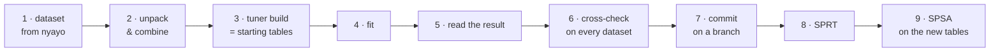

# Tuning the evaluation tables, step by step

How a table fit goes from games in nyayo to an SPRT, with the setup as it is (1.6, `search-time`). Each step lists
what you can vary there and what it costs. The theory, the options' reference and the code map are in
[src/tuner/README.md](../src/tuner/README.md); this is the workflow around it.



---

## 1 · Get a dataset from nyayo

nyayo's Exports page (`/exports`, *New dataset*) or `POST /api/exports` makes `positions-<id>.txt.zst`: up to ten quiet
positions a game, drawn by `phant-indexer --draw 10 --quiet` with a recorded seed, deduplicated across the whole
dataset, each line `<fen> [result]`. A dataset can be rebuilt byte for byte from its record.

**Variations**

| Choice | Options | Consider |
|:--|:--|:--|
| Date (*no games before*) | any date, or none | The era of the games. `positions-3` was "since 2026-10-30", games of 1.4 and later. Newer games are closer to what the engine plays now and their results carry less blunder noise. |
| Players | any engine names as they report over UCI (`Elephant 1.4.0`, `Stash 36`, …), a game is taken when either side is one | Self-play only (SPRTs) vs games against other engines (gauntlets). Self-play is most of the volume; gauntlet games see positions Elephant wouldn't steer into. |
| Merge | on / off | On writes a repeated position once with its results averaged (`[0.75]`); off keeps the first. Matters for opening-heavy data. |
| Books | fixed by nyayo: positions start at ply 4 for `8moves_v3`, 0 for `Endgames`, 8 for any other book (`NYAYO_BOOK_MIN_PLY`) | Not a form option; it keeps book moves out. |
| Positions a game | fixed at 10, quiet only | Not a form option. Fewer per game would cut correlation between positions of one game; it needs a change in nyayo. |

## 2 · Unpack and combine

The tuner reads plain text, one position a line (`[1.0]`, `c9 "1-0";` or a bare result all work, CRLF or LF), not
`.zst`. There's no `zstd` on Windows or in WSL here; unpack with nyayo's Python, which has `zstandard`:

```
D:/dev/nyayo/.venv/Scripts/python -c "import zstandard,sys; zstandard.ZstdDecompressor().copy_stream(open(sys.argv[1],'rb'), open(sys.argv[2],'wb'))" positions-3.txt.zst positions-3.txt
```

Datasets live in `res/tuning_positions/` (ignored by git). What's there:

| File | Positions | What |
|:--|--:|:--|
| `E12.52-1M-D12-Resolved.book` | 10.0M | Ethereal's, every table since 1.1 was fitted on it |
| `E12.33-…`, `E12.41-…` | | older Ethereal sets, unused |
| `E12.46FRC-…` | | Ethereal's Chess960 (FRC) set, unused |
| `lichess-big3-resolved.book` | | human games, unused |
| `elephant-positions-0.1.book` | 1.2M | Elephant's games before 1.4 (1.4.0's own-games fine-tune) |
| `positions-3.txt` | 1.45M | Elephant's games since 1.4 (1.6's `search-time-stride-fit`) |
| `joint-e12-own01-own3.book` | 12.6M | E12.52 + 0.1 + positions-3, concatenated |

**Variations**

- **One set or several.** The tuner takes one file, so combining is concatenating: `cat a b c > joint.book`. Check
  that every file ends with a newline first (`tail -c1 file | od -c`), or two positions join on one line.
- **Weighting.** There's no weight option. Repeating a file in the concatenation counts it twice; positions-3 twice
  in the joint set would be ~21% of it instead of ~11%.
- **Overlap.** Datasets drawn from the same games overlap; check with
  `comm -12 <(cut -d' ' -f1-4 a | sort -u) <(cut -d' ' -f1-4 b | sort -u) | wc -l`. 0.1 and positions-3 share 0.5%.
- **Result mix.** `awk '{r[$NF]++} END{for(k in r) print k, r[k]}' file`. Self-play at short time controls is draw
  heavy (positions-3: 52% draws), which makes K larger, see step 4.

## 3 · Build the tuner: its tables are the starting point

The fit starts from the values compiled into `phant-tuner`, the engine's own headers in `src/engine/inc/eval/`. Choosing
a start is choosing what the tree holds when you build.

```
cmake --build .build/win-release-native --config Release --target phant-tuner    # -> dist/phant-tuner.exe
```

Check that the binary carries the tree's tables before a long run, a writer check on a few positions (exit 0):

```
dist/phant-tuner.exe res/tuning_positions/positions-3.txt --epochs 0 --limit 20000 --free-mobility --free-psqt --out .build/check
```

The `--free-*` flags are needed there: with centring on, `--epochs 0 --limit` re-centres on the small sample and fails
the check (a known quirk, not a broken build).

**Variations**

| Start | How | When |
|:--|:--|:--|
| The current tables | build the branch as it is | a refinement, the usual case |
| An older version's tables | a worktree at that commit (`git worktree add ../elephant-old <sha>`), build there | comparing against a release, or refitting from before a change that didn't hold up |
| Another fit's output | copy the `*.tuned.hpp` over the headers in a worktree, build | a second fit on top of a first (sequential fine-tuning) |

Build anything other than your own tree's tables in a **worktree**, never by swapping headers in your checkout.

> **Gotcha:** `Copy-Item` and `cp -p` keep the copied file's timestamp. A header older than the build's objects isn't
> rebuilt, and the tuner silently runs on the old tables. Touch the headers after copying
> (`(Get-Item $f).LastWriteTime = Get-Date`), and always confirm with the writer check that the binary's tables are
> the files' (exit 0).

## 4 · Run the fit

```
dist/phant-tuner.exe <dataset> --tune <groups> --min-usage <N> --out <dir> [--epochs 1000] [--rate 1.0]
```

A 12.6M position fit, 1000 passes, takes about four minutes on 24 threads; 1.45M takes under a minute. Phase 0
(reading and quiescing every position) is most of it for small sets.

**K** is found first on the starting tables and fixed for the run: the dataset decides it, there's no option to set
it. E12.52 lands near 1.16–1.19, Elephant's own games higher (0.1 at 1.26, positions-3 at 1.35). A concatenation gets
one K, a compromise between its sets.

**Variations**

| Option | Choices | Consider |
|:--|:--|:--|
| `--tune` | groups, comma separated: `material`, `psqt` or `psqt_pawn` … `psqt_king`, `mobility`, `pawns_passed`, `pawns_structure`, `pawns_passed_extras`, `king_shelter`, `king_attack`, `pieces_pairs` | The 1.4 and 1.6 fits used `psqt_pawn,psqt_knight,psqt_bishop,psqt_rook,psqt_queen,mobility,pawns_passed,pawns_structure,pawns_passed_extras,king_shelter,pieces_pairs`. Left out on purpose: `material` (trades with the PSQTs' averages), `psqt_king` (learned an artefact on ranks 5–8), `king_attack` (made kingDanger jagged; fit it alone and make it monotonic by hand). A new term is fitted alone first with everything else kept. |
| `--min-usage` | a count of positions | Values fewer positions use are kept as they are. 0.5% of the dataset has worked: 50000 on E12.52, 6000–7250 on 1.2–1.45M, 63000 on the joint set. Lower lets sparse tails (queen mobility at 0 squares, rank-7 cells) swing on noise. |
| Centring | on (default), `--free-psqt`, `--free-mobility` | On keeps each table's average, so pieces keep their values and only shapes move. Off let a joint fit move averages by up to 175 cp and re-price the pieces; keep it on unless that's the point of the run. |
| `--epochs`, `--rate` | 1000 and 1.0 | Fits settle by pass 100–200; 1000 is cheap insurance. A smaller rate (0.5) for a fine-tune from good tables moves less per pass, it rarely changes the end point. |
| `--held-back` | every 20th position (default), 0 for none | Keep it: the held-back error is the number that counts. |
| `--limit` | first N positions | Quick tries of a group choice before the full run. |
| `--threads`, `--leave` | all cores | `--leave 2` keeps the machine usable. Results are identical for any thread count. |

## 5 · Read the result

The log ends with the fitted and held-back error after rounding, both against the start. Look for:

- **Held back falls about as much as fitted.** positions-3: fitted 0.82% lower, held back 0.57%: some overfitting,
  normal on 1.45M. A held-back drop near zero with a fitted one means the fit memorised.
- **The table moves.** Average change per value has been 4–7 cp; individual values up to ~90 in sparse cells. A
  quick check of what moved:
  `diff <(grep -o 'S([^)]*)' src/engine/inc/eval/pesto_tables.hpp) <(grep -o 'S([^)]*)' out/pesto_tables.tuned.hpp) | head`
- **Artefacts.** Sparse tails swinging (queen mobility 0–2 squares), kingDanger no longer monotonic, known oddities
  (connected pawn on rank 7, 200/16) coming back. Raise `--min-usage` or leave the group out.
- **Pieces' values.** With centring on, a table's average doesn't move; if a piece's average did, centring was off.

## 6 · Cross-check on every dataset

A fit is judged on data it wasn't fitted on. Build a tuner per table set (step 3, a worktree per set, touch the
headers), and run each on each dataset without fitting:

```
phant-tuner <dataset> --epochs 0 --free-mobility --free-psqt --out <scratch>
```

It prints the best K and the error at that K for its compiled tables. Every run must end with the writer check
passing (exit 0), or it wasn't the tables you meant. What 1.6's check looked like:

| Tables | E12.52 | own 0.1 | positions-3 |
|:--|--:|--:|--:|
| 1.4.0 | 0.085307 | 0.091185 | 0.086970 |
| joint | −1.03% | +0.77% | −0.18% |
| positions-3 alone | −0.26% | +0.74% | −0.85% |

Read each cell knowing which sets a table was fitted on: a gain on a set it was fitted on is flattered, a gain on a
set it never saw is the real signal. E12.52 accuracy alone doesn't predict Elo: 1.4's own-games fit lost 1.13% on
E12.52 and won +9.

**Variations**

- **The comparison set.** Add a set no candidate was fitted on (a newer nyayo export, a gauntlet-only export) and it
  becomes the fairest judge.
- **K shift.** A higher best K on the same data means the new tables evaluate smaller numbers; the search's
  centipawn margins then prune a little harder. Note it in the commit; step 9 re-tunes the margins.

## 7 · Commit on a branch

A table fit is an evaluation change: its own branch off the cycle branch, `<cycle>-<change>`
(`search-time-stride-fit`), in a worktree.

1. Copy the five `*.tuned.hpp` over `src/engine/inc/eval/*.hpp`. The writer kept the headers' comments and layout.
2. Add a paragraph to the comment at the top of each table file: the dataset (name, size, where from), K, the
   groups and kept values if they differ from the last fit, the held-back result and the cross-check. The previous
   fits' paragraphs stay; the comment is the tables' history.
3. Commit with the paths named. The `prepare-commit-msg` hook builds `ob_build/makefile` with g++ in WSL, runs the
   bench and adds `bench N nodes`; nyayo reads it from there.
4. Push.

Search parameter changes (an SPSA result) are a separate commit, in `src/engine/inc/search/core/search_tunables.def`.

## 8 · SPRT

```
python test/ob_sprt.py <dev-branch> <base-branch> [--priority -1] [--book UHO_Lichess_4852_v1.epd] [--dry-run]
```

It queues the test on nyayo (`git config nyayo.token`). Branches cut from `search-time` before 1.6 carry an older copy
that posts to the retired OpenBench server; run a current copy from `git show search-time:test/ob_sprt.py`. Both
branches must be pushed and the base's tip must carry a bench line.

**Variations**

| Choice | Options | Consider |
|:--|:--|:--|
| Bounds | STC [0, 5] (default), `--nonreg` [-3, 1], `--bounds a,b` | STC finds the gain; the LTC confirms it doesn't lose at longer time controls as a non-regression test (`--ltc --nonreg`). |
| Book | the preset's `8moves_v3.epd`, or `--book UHO_Lichess_4852_v1.epd` | 1.4's table tests ran on UHO, which stretches Elo next to 8moves; compare results only within one book. |
| Base | the cycle branch, or another candidate | Against the cycle branch measures everything on the branch together; against a branch that differs only by the tables measures the fit alone. |
| Priority | 0, 1 (goes first), -1 (waits for the rest) | The worker only plays the highest priority's tests. |

## 9 · Re-tune the search on the new tables

Fits and search margins depend on each other: SPSA tunes margins in the evaluation's centipawns, a fit changes what a
centipawn is. One round is: fit → SPRT → SPSA on the fitted tables → SPRT the tune. The defaults SPSA finds go into
`search_tunables.def`.

---

## Open ends in the tooling

- **No weights or K per dataset.** Mixing sets means one K and concatenation for weights. A per-file weight or K in
  the tuner would make joint fits fairer; worth doing if joint fits keep losing on the newest data.
- **No out-of-sample set in the cross-check.** Every candidate is partly judged on data it was fitted on, see step 6.
- **`--epochs 0 --limit` fails the writer check with centring on**, see step 3.
