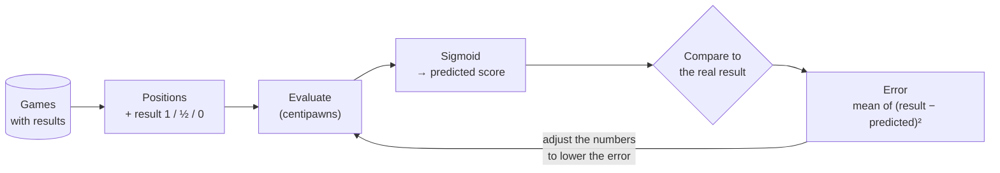
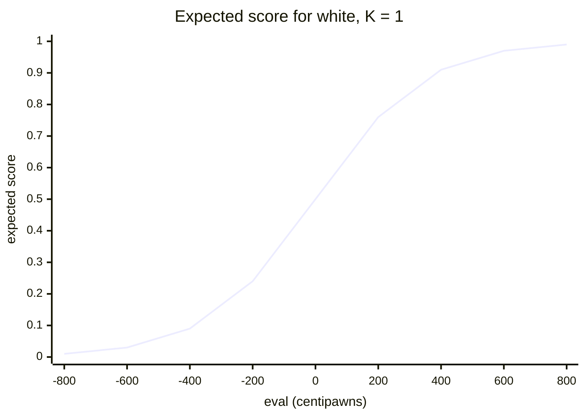
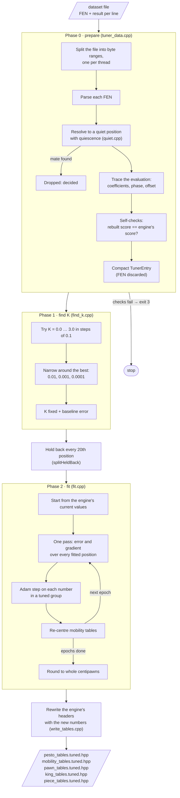
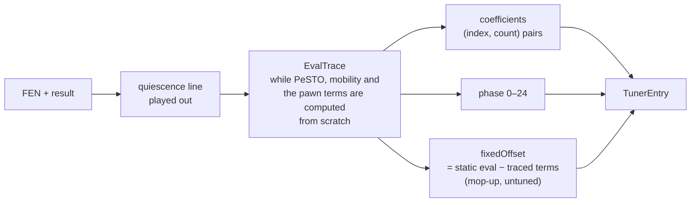
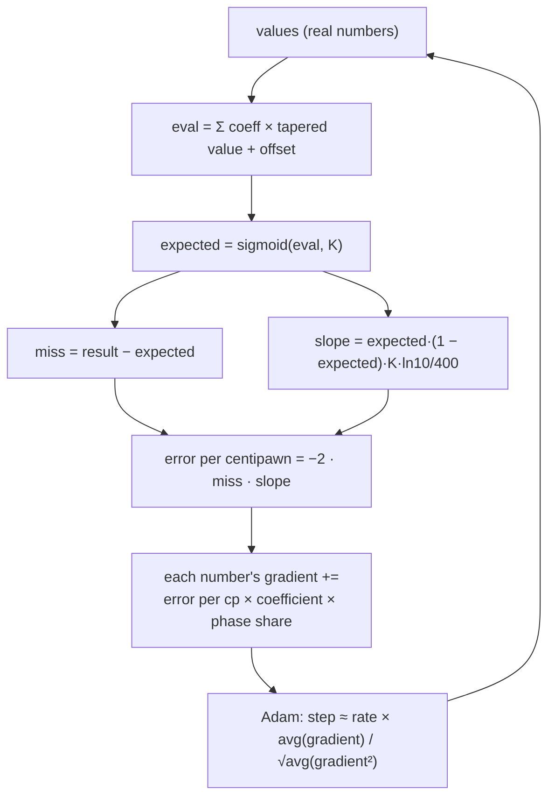
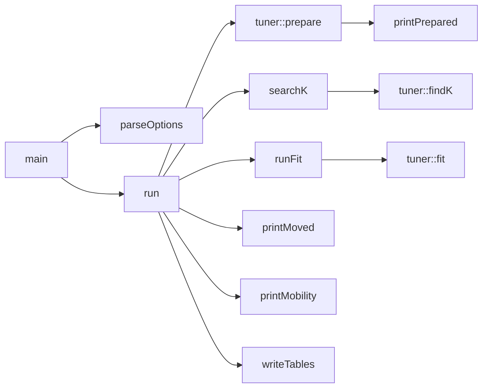

# ElephantTuner

The offline tuner for Elephant's evaluation. It takes positions from real games, each labelled with the game's
result, and adjusts the evaluation's numbers until the evaluation predicts those results as well as it can. The output
is new copies of `pesto_tables.hpp`, `mobility_tables.hpp`, `pawn_tables.hpp`, `king_tables.hpp` and `piece_tables.hpp`, ready to drop
into the engine.

- [How evaluation tuning works](#how-evaluation-tuning-works), the idea in general
- [How this tuner works](#how-this-tuner-works), phase by phase
- [Running it](#running-it)
- [Where things are in the code](#where-things-are-in-the-code)

---

## How evaluation tuning works

An evaluation function says "white is +80 centipawns better here". It doesn't say who will win. Tuning connects the
two. The method is often called *Texel tuning*, after the engine that made it popular:

1. Collect a lot of positions from finished games and note who won each game: 1 for white, 0.5 for a draw, 0 for
   black.
2. Turn each position's evaluation into a predicted score with an S-shaped curve (a sigmoid). +0 becomes 50%, a large
   plus becomes nearly 100%, a large minus nearly 0%.
3. Measure how wrong the predictions are: the average of `(result − prediction)²` over every position. This is the
   **error** (mean squared error).
4. Adjust the evaluation's numbers to lower that error, over and over, until it stops falling.



Each game result on its own is noisy: a winning position gets drawn, a blunder throws a game away. Over millions of
positions the noise averages out. What's left is a strong signal: positions where the evaluation says +200 should be
won much more often than positions where it says +20.

### The sigmoid and K

```
expected(eval) = 1 / (1 + 10^(−K · eval / 400))
```



**K** sets how steep the curve is, so it decides how many centipawns count as "probably winning". It has to be fixed
before tuning. If K and the evaluation's numbers could both move, they would trade places: doubling every number and
halving K gives the same predictions. The tuner could then scale every value up or down without improving anything, and
the search's centipawn margins (futility, delta pruning) would stop meaning what they were written to mean.

### Why quiet positions

The static evaluation can't see a capture that is about to happen. A position in the middle of a queen trade looks a
queen up for one side. Tuning on positions like that teaches the evaluation nonsense. So every position is first
played forward with quiescence search until nothing is hanging, and the tuner fits on that quiet position instead.

### Why a linear model makes this fast

Most of Elephant's evaluation is a sum: material + piece-square values + mobility values, each blended between a
midgame and an endgame number by the game phase. So a position's evaluation is just

```
eval = Σ coefficient × (mg × phase/24 + eg × (24 − phase)/24) + offset
```

where a **coefficient** counts how many times the position uses that value (white's uses minus black's). Record the
coefficients once and the engine is no longer needed. The tuner can re-evaluate millions of positions with any set of
numbers in a fraction of a second, and work out exactly which way each number should move (its **gradient**).

---

## How this tuner works

Three phases, run in order by [`src/main.cpp`](src/main.cpp):



### Phase 0: preparing the data

Source: [`tuner_data.hpp`](inc/tuner_data.hpp), [`quiet.hpp`](inc/quiet.hpp), [`trace.hpp`](inc/trace.hpp),
[`dataset.hpp`](inc/dataset.hpp)

The tuner never keeps the FENs. Each position becomes a ~16-byte `TunerEntry` plus a short list of 2-byte
`Coefficient`s:



The values are laid out at fixed indexes (`params::` in [`trace.hpp`](inc/trace.hpp)), 653 in all, each with a
midgame and an endgame number:

| Group                 | Indexes   | What                                                                       |
|-----------------------|-----------|----------------------------------------------------------------------------|
| `material`            | 0–5       | piece values, pawn to king                                                 |
| `psqt_pawn` … `psqt_king` | 6–389 | 6 piece-square tables × 64 squares, a group per piece, 64 each; `psqt` names all six |
| `mobility`            | 390–455   | knight 0–8, bishop 0–13, rook 0–14, queen 0–27 safe squares                |
| `pawns_passed`        | 456–461   | passed pawns by relative rank 2–7                                          |
| `pawns_structure`     | 462–479   | isolated, doubled & backward by file folded onto a–d, connected by rank 2–7 |
| `pawns_passed_extras` | 480–509   | passed pawns by own & enemy king distance 0–7, blocked & free path by rank 2–7, own & enemy rook behind |
| `king_shelter`        | 510–581   | king shelter & unblocked storm by file folded onto a–d × no pawn & rank 2–7 (8 each), blocked storm by rank |
| `king_attack`         | 582–645   | king danger by attack units 0–63 (unit weights hand-set in `king_tables.hpp`) |
| `pieces_pairs`        | 646–648   | knight pair, bishop pair & rook pair                                       |
| `pieces_files`        | 649–652   | rook, then queen, on a half-open & an open file                            |

A group is the unit `--tune` switches on or off, its parts are only where each term's values sit inside it. A new
group is an entry in `params::Group`, a name in `groupInfos` and a start in `groupStarts`; the `static_assert`s on
the group boundaries fail the build when the layout and the groups disagree.

Two checks guard this phase. If either finds a mismatch, the tuner stops with exit code 3:

- **accumulator**: PeSTO's sums traced from scratch on the quiet position must equal the incremental sums the
  quiescence line's moves left behind.
- **rebuild**: coefficients × the engine's current values must give exactly the engine's own tapered score. This proves
  the linear model really is the evaluation.

Threads each read their own byte range of the file. Their results are joined in range order, so the data (and its
printed checksum) is identical for any thread count.

### Phase 1: finding K

Source: [`find_k.hpp`](inc/find_k.hpp)

With the engine's current evaluation, the error is computed for K = 0.0, 0.1, … 3.0. The error has one valley, so the
search then narrows around the best K in finer and finer steps. That K is fixed for the rest of the run. The error at
that K is the **baseline** that tuning has to beat. The tuner also prints a second reference: the error of predicting
50% for every position, which is what "knowing nothing" scores.

### Held-back positions

Before fitting, every 20th position is set aside (`--held-back`). The fit never sees those positions, so their error
shows whether the tuner learned something general or just memorised the positions it was given:

| fitted error | held-back error | means                                              |
|--------------|-----------------|----------------------------------------------------|
| falling      | falling         | learning, good                                     |
| falling      | flat or rising  | overfitting, more data or fewer values needed      |

The held-back error after rounding is the number to judge a run by.

### Phase 2: the fit

Source: [`fit.hpp`](inc/fit.hpp) (it has the full derivation)

Each pass (an **epoch**) goes over every fitted position once:



- **The gradient** of a number says which way the error moves if that number goes up a little. Moving each number
  slightly against its gradient lowers the error.
- **Adam** gives each number its own step size. A material value sees a huge gradient and a rarely used square a tiny
  one, so one fixed step can't suit both. With Adam every number moves about `--rate` centipawns per pass while its
  push is steady, and less once the pushes start to disagree near its best value.
- **Groups held fixed.** Only the groups named in `--tune` move. The rest still count in every evaluation. This is how
  a new term joins an evaluation the search is used to. With PeSTO fixed, mobility only picks up what PeSTO doesn't
  already say.
- **Mobility is kept centred.** After every step, each piece's mobility table is shifted so its usage-weighted average
  is 0. Otherwise the table's average acts as a second material value, and the fit uses it to re-price the pieces (it
  lowered every piece's midgame value by about 60 that way). `--free-mobility` turns centring off.
- **The tuned piece square tables are kept centred** on the usage-weighted average each starts with. A table's
  average is part of what its piece is worth, and fitted together with everything else the tables moved their
  averages by up to 175 centipawns in the endgame, re-pricing the pieces. Centred, a table only learns where its piece
  stands better or worse. `--free-psqt` turns this off.
- **Rarely used values can be kept.** `--min-usage N` leaves every value fewer than N positions use as it is; a value
  fitted on a few thousand positions is fitted on noise. Centring then moves only the values that aren't kept.
- **Material and PSQT don't tune together by default.** Adding the same amount to every square of a table is the same
  as adding it to the piece's value. The two would trade back and forth without changing the error.

Threads split the positions into slices and the slices' sums are added in order, so the result is the same for any
thread count.

### Writing the result

The tuned values are rounded to whole centipawns, the form the engine stores them in. The tuner prints the rounded
error too, so you can see what rounding costs. Then it rewrites the engine's own `pesto_tables.hpp`,
`mobility_tables.hpp`, `pawn_tables.hpp`, `king_tables.hpp` and `piece_tables.hpp`, replacing only the numbers inside the tables and keeping comments and
layout, and saves them as `*.tuned.hpp` in `--out`. Copying one over the engine's file is the change; the comment at
the top of the table file is where to note the run (dataset, K, passes, error before and after).

`--epochs 0` writes the untouched values back out. The files must come out byte-identical to the engine's, which checks
the writer itself (exit code 4 if they don't).

---

## Running it

```
ElephantTuner <dataset> [--limit N] [--threads N] [--leave N] [--epochs N] [--rate R]
              [--tune LIST] [--out DIR] [--held-back N] [--free-mobility] [--free-psqt] [--min-usage N]
```

| Option            | Default         | Meaning                                                      |
|-------------------|-----------------|--------------------------------------------------------------|
| `dataset`         | (required)      | one position per line: FEN and result (`[1.0]`, `c9 "1-0";`, or bare `1-0`) |
| `--limit`         | all             | only the first N positions                                   |
| `--threads`       | all cores       | threads to use                                               |
| `--leave`         | 0               | cores to keep free, taken off `--threads`                    |
| `--epochs`        | 1000            | passes of the fit; 0 only checks the writer                  |
| `--rate`          | 1.0             | Adam's step, roughly centipawns moved per pass               |
| `--tune`          | `psqt,mobility` | groups the fit moves, comma separated, any of `material`, `psqt` (or `psqt_pawn` … `psqt_king`), `mobility`, `pawns_passed`, `pawns_structure`, `pawns_passed_extras`, `king_shelter`, `king_attack`, `pieces_pairs`, `pieces_files` |
| `--out`           | `.`             | folder for the `*.tuned.hpp` files                           |
| `--held-back`     | 20              | every Nth position is kept out of the fit, 0 for none        |
| `--free-mobility` | off             | don't keep mobility's tables centred                         |
| `--free-psqt`     | off             | don't keep the tuned piece square tables centred             |
| `--min-usage`     | 0               | keep the values fewer than N positions use as they are       |

| Exit code | Meaning                                          |
|-----------|--------------------------------------------------|
| 0         | done                                             |
| 1         | an error (file I/O, …) or no usable positions    |
| 2         | bad command line                                 |
| 3         | phase 0's self-checks failed                     |
| 4         | writer check failed (`--epochs 0`)               |

---

## Where things are in the code

| File                                         | Role                                                      |
|----------------------------------------------|-----------------------------------------------------------|
| [`src/main.cpp`](src/main.cpp)               | command line, runs the phases, prints the report          |
| [`inc/dataset.hpp`](inc/dataset.hpp)         | reading and splitting the dataset file                    |
| [`inc/quiet.hpp`](inc/quiet.hpp)             | resolving a position to a quiet one                       |
| [`inc/trace.hpp`](inc/trace.hpp)             | the value layout (`params::`) and the coefficient tracer  |
| [`inc/tuner_data.hpp`](inc/tuner_data.hpp)   | phase 0, entries, held-back split                         |
| [`inc/find_k.hpp`](inc/find_k.hpp)           | phase 1, the sigmoid, the error, the K search             |
| [`inc/fit.hpp`](inc/fit.hpp)                 | phase 2, gradient descent with Adam                       |
| [`inc/write_tables.hpp`](inc/write_tables.hpp) | writing tuned values back into the engine's headers     |

In `main.cpp`, `main` parses the options (`parseOptions`) and hands them to `run`, which calls one function per phase:


